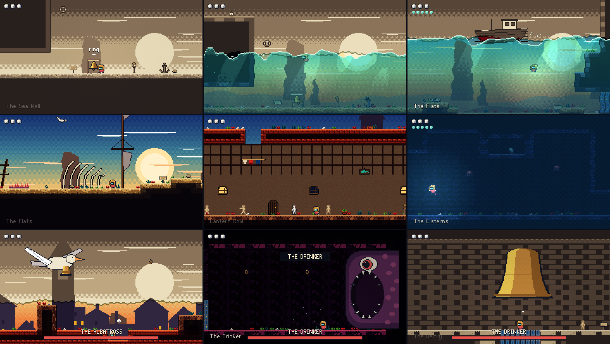

# Bellwater

*The sea left Bellwater when you were small. Today you heard a bell.*



A small metroidvania made in Godot 4.7 (GDScript). You are the last bell-ringer's grandchild in a
bleached, dry harbour town. Ring the tide bells to call the sea back: it rises through one continuous
world, floats you to places you couldn't reach, and leaves everything it touches in colour.

About 35-40 minutes to finish, going by the first full playthrough.

## Play it

In English and Italian: it follows your system's language, and Options changes it.

Get it from [itch.io](https://fourlastor.itch.io/bellwater), for Linux, Windows and macOS. The Windows
and Mac builds aren't notarized or signed with a paid certificate, so both systems ask the first time:

- **Windows:** More info, then Run anyway.
- **macOS:** System Settings, Privacy & Security, then Open Anyway. Or:
  `xattr -dr com.apple.quarantine Bellwater.app`

Or build it yourself with Godot 4.7.2 (set `GODOT` to the editor if it isn't found):

```bash
tools/export.sh linux
```

```bash
build/linux/bellwater.x86_64
```

`tools/export.sh windows` and `tools/export.sh macos` work the same way from Linux. The Mac build is signed
ad hoc with [rcodesign](https://github.com/indygreg/apple-platform-rs), because newer versions of macOS refuse
to start Godot's own signature: set `RCODESIGN` to its path if it isn't on `PATH`.

## Controls

| Action | Keyboard | Gamepad |
|---|---|---|
| Move / aim | Arrows or WASD | D-pad / left stick |
| Jump | Space, Z or K | A |
| Boathook | X or J (hold Up or Down to aim) | X |
| Cast the Reel (after you find it) | C or L | B |
| Ring, read, rest | Up or E | Up, LB or RB |
| Dive (after the Helm) | Hold Down in water | Down |
| Tuning Fork (late game) | F or V | Y |
| Map and pause | Tab, M or Esc | Back / Start |

## How the sea works

- One tide height applies to the whole world. Ringing a bell sends it to that bell's mark; the
  stripes on the bell's post count the level.
- You float. Anything under the surface is out of reach until you can dive.
- Rising water carries you up. The Well in the middle of the world is a lift: each tide level brings you
  level with a different pair of doors.
- Falling water opens the low places again, and leaves them in colour.
- Loose sand washes away the first time the sea touches it.
- Lost? *Back to last lamp* in the pause menu always gets you out.

## What's in the box

```
data/rooms/    the 25 rooms, as generated text
data/lang/     the Italian translation (a standard .po file, keyed by the English text)
scripts/       the game (core/, entities/, enemies/, bosses/, ui/)
shaders/       ocean.gdshader (the sea), grade.gdshader (the sepia)
tools/         everything that generates the game's content
tests/         the automated checks
DESIGN.md      design notes: tide levels, progression, world layout
```

All art, music and sound is original and generated by the Python in `tools/`, with no third-party
assets. To change something, edit the generator rather than the output:

```bash
uv venv .venv && uv pip install --python .venv/bin/python pillow numpy scipy
PYTHONPATH=tools .venv/bin/python tools/world.py   # rooms
tools/build_art.sh                                  # images
tools/gen_splash.sh                                 # the boot splash, rendered by the game itself
PYTHONPATH=tools .venv/bin/python tools/gen_audio.py # music and sound
```

## Tests

```bash
tools/check.sh              # every boss to the death, the ending, a soak of every room, every translation
```

```bash
tools/run_route.sh          # proves the game can be finished, gates hold, and every item is reachable
```

```bash
tools/run_gamepad.sh        # plays the real game with gamepad events only (needs xvfb)
```

`tests/route.gd` searches over the real `Player.tick()` on the real map, so "reachable" means physically
reachable; it takes about 8 minutes. `tests/flow.gd` drives the real menus with the keyboard actions.

## Publishing

Every push to `main` runs `.github/workflows/publish.yml`: import, `tools/check.sh`, `tools/export.sh` for each
platform, then butler pushes to the `linux`, `windows` and `mac` channels of `fourlastor/bellwater`, using the
`BUTLER_API_KEY` secret. A build's version on itch is the commit it was made from.

`.github/workflows/check-builds.yml` is started by hand: it fetches the published Mac and Windows builds and
tries them on real systems, because neither can run on the Linux runner that makes them.

```bash
gh workflow run check-builds.yml
```
